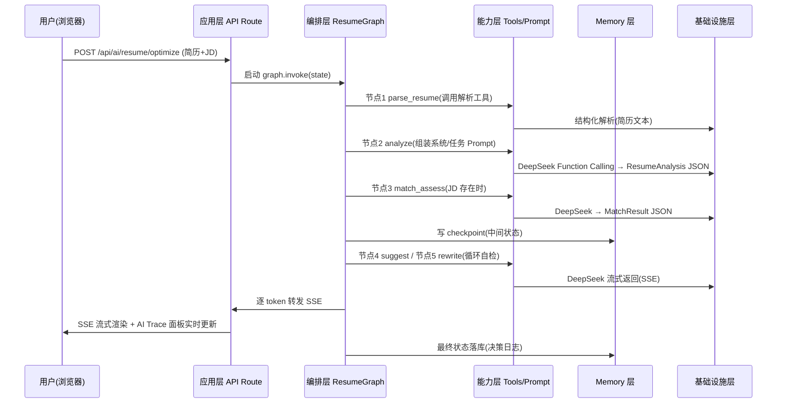
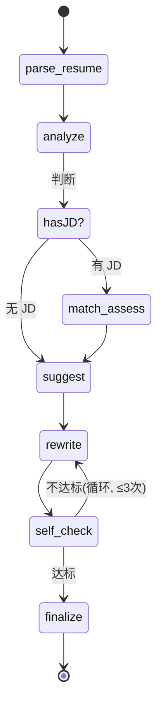
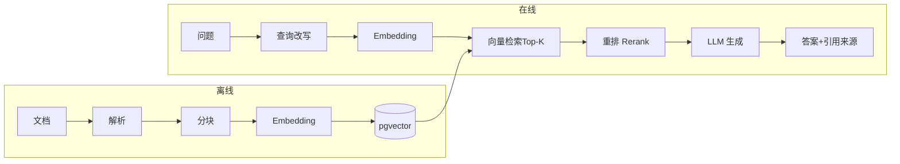
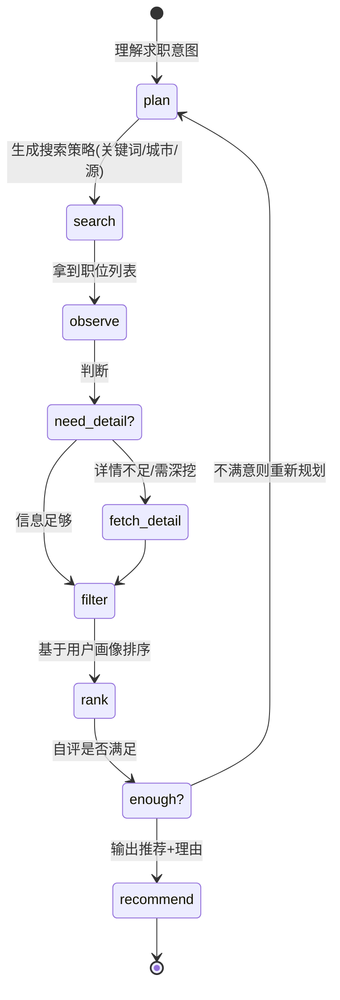

# CareerAI 智能求职平台 · AI 应用体系架构设计文档

> 架构师：高见远 | 状态：架构设计（不涉及代码实现）

---

## 1. 总体结论

**一句话定位**：CareerAI 当前是「单点 AI 调用」（一次 `fetch` 直连 DeepSeek、无结构化输出、无编排、无记忆、无检索），目标是升级为「**可编排、可记忆、可检索、可观测、可学习**」的分层 AI 应用体系——以 **LangGraph.js（编排）+ LangChain.js（积木）+ DeepSeek（模型）+ pgvector（检索/记忆）** 为核心，在**复用现有 Node.js/PostgreSQL/Next.js 技术栈、零重写**的前提下，把简历优化、工作台、职位发现三大模块分别落到 **Agent 编排、RAG、自主规划** 三条标准 AI 范式上，并以「AI Trace + 决策日志 + 模块化测试」作为贯穿全局的**学习导向**差异化能力。

核心方案的四个关键决策（每个都能回答"为何帮助学习者理解 AI"）：

| 决策 | 选择 | 一句话理由 | 学习价值 |
|---|---|---|---|
| 编排引擎 | **LangGraph.js**（非纯 LangChain 链式） | 三大模块都需要"循环 + 条件分支 + 状态留存"，链式表达不了 | 可视化理解 Agent 的状态机、循环、checkpoint |
| 模型接入 | **DeepSeek（OpenAI 兼容 + Function Calling）** | 已接入、成本低、支持 tool calling | 理解 LLM 的"结构化输出"本质 |
| 向量检索 | **pgvector（复用 PostgreSQL 16）** | 零新组件，SQL 即查询，过滤/混合检索方便 | 理解向量本质就是"高维坐标+距离"，可 SQL 直查 |
| 观测体系 | **AI Trace + 决策日志（自建轻量方案）** | LangSmith 重且付费，自建贴合学习目标 | 每一步 Prompt/Tool/检索结果透明可见 |

---

## 2. 整体分层架构

### 2.1 五层架构

```
┌─────────────────────────────────────────────────────────────────┐
│  应用层 Application   Next.js(App Router) + 子应用(qiankun)       │
│                      API Route / 页面 / AI Trace 面板             │
├─────────────────────────────────────────────────────────────────┤
│  编排层 Orchestration  LangGraph 状态图(ResumeGraph/RAGGraph/     │
│                        JobGraph) + Agent 决策循环 + State/Checkpoint│
├─────────────────────────────────────────────────────────────────┤
│  能力层 Capability     Prompt 模板 / Tools(FC+MCP) / RAG 检索 /    │
│                        解析器 / 评估器 / 重排器                    │
├─────────────────────────────────────────────────────────────────┤
│  Memory 层            短期(会话窗口) / 长期(checkpoint 状态) /     │
│                        向量(知识库+用户画像) / 结构化画像           │
├─────────────────────────────────────────────────────────────────┤
│  基础设施层 Infra      DeepSeek(LLM) / Embedding+Rerank 模型 /     │
│                        pgvector / PostgreSQL / SSE 网关 / MCP Server│
└─────────────────────────────────────────────────────────────────┘
```

### 2.2 每层职责

| 层 | 职责 | 关键组件 |
|---|---|---|
| 应用层 | 接收用户请求、渲染结果、展示 AI 过程 | Next.js API Route（`/api/ai/*`）、SSE 消费端、AI Trace 面板 |
| 编排层 | 定义业务流程为状态图，驱动多步推理、条件路由、循环、异常回退 | LangGraph `StateGraph`、`Node`、`ConditionalEdge`、Checkpointer |
| 能力层 | 提供可复用"原子能力"（一句话 Prompt、一个 Tool、一次检索） | Prompt 模板、Tool 定义、RAG Retriever、评估器 |
| Memory 层 | 让 AI"记住"：本轮上下文、跨轮状态、长期知识、用户偏好 | 消息窗口、PostgresSaver、pgvector 知识库、用户画像表 |
| 基础设施层 | 无状态的底层服务，与业务解耦 | DeepSeek、Embedding/Rerank 服务、pgvector、SSE 通道、MCP Server |

### 2.3 一次请求的数据流（以「简历优化-岗位匹配」为例）



**分层要点**：编排层只管"流程怎么走"，能力层只管"每步怎么做"，Memory 层只管"记住什么"，基础设施层只管"用什么模型/库"。四层之间通过 **State 对象（TypedState）** 传递数据，实现松耦合。

---

## 3. 三大模块 AI 能力设计

## 3.1 简历优化模块（Prompt 工程 + Agent 编排 + Function Calling）

### 3.1.1 Prompt 工程分层（四层模板）

| 层 | 职责 | 示例（简历优化场景） |
|---|---|---|
| **系统级 System** | 定角色、边界、安全、全局规则 | "你是资深 HR 与简历诊断专家，只输出结构化 JSON，不虚构经历，不夸大事实" |
| **任务级 Task** | 定义本次具体任务 | "对以下简历做整体评分，并识别标签/亮点/短板" |
| **输出约束 Output** | 用 JSON Schema 锁死输出格式 | `{ overall_score, tags[], highlights[], weaknesses[], suggestions[] }` |
| **Few-shot/变量注入** | 提升稳定性 + 个性化 | 注入简历原文、岗位 JD、用户画像（目标行业/城市） |

**设计原则**：
- Prompt 全部模板化存于 `ai/prompts/` 目录，**禁止散落在 service 里**（学习价值：Prompt 版本可管理、可对比、可 A/B）。
- 系统级 Prompt 全局共享，任务级 Prompt 按模块拆分，输出约束与 Function Calling JSON Schema **共用一份定义**（避免"Prompt 说要 JSON"和"Schema 定义"两处漂移）。

### 3.1.2 LangGraph 状态图节点设计



**State 定义（TypedState）**：

```ts
interface ResumeState {
  resumeText: string;          // 原始简历
  jobDescription?: string;     // 可选岗位 JD
  parsed: ParsedResume;        // 解析结果
  analysis?: ResumeAnalysis;   // 评分/标签/亮点
  match?: MatchResult;         // 岗位匹配度
  suggestions: string[];       // 改进建议
  rewritten: RewriteResult[];  // 改写结果
  selfCheck?: SelfCheckResult; // 自检结果
  iteration: number;           // 循环计数
  messages: BaseMessage[];     // 对话历史(多轮迭代)
  userId: string;
}
```

| 节点 | 输入 → 输出 | 使用的能力 |
|---|---|---|
| `parse_resume` | resumeText → parsed | 解析工具（mammoth/pdf2json 已具备） |
| `analyze` | parsed → analysis | DeepSeek + FC Tool `analyze_resume` |
| `match_assess` | parsed + JD → match | FC Tool `evaluate_match` |
| `suggest` | analysis/match → suggestions | FC Tool `suggest_improvements` |
| `rewrite` | 指定段落 + 建议 → rewritten | FC Tool `rewrite_section`（对话式迭代入口） |
| `self_check` | rewritten → selfCheck | 自评 Prompt（判断是否达标 → 条件路由循环） |
| `finalize` | 汇总 → 统一输出 | 格式约束 Prompt |

### 3.1.3 Function Calling JSON Schema 设计

```jsonc
// Tool: analyze_resume —— 简历结构化分析
{
  "name": "analyze_resume",
  "description": "对简历做整体诊断，输出评分、标签、亮点与短板",
  "parameters": {
    "type": "object",
    "properties": {
      "overall_score": { "type": "integer", "minimum": 0, "maximum": 100 },
      "tags": { "type": "array", "items": { "type": "string" } },
      "highlights": {
        "type": "array",
        "items": {
          "type": "object",
          "properties": {
            "point": { "type": "string" },
            "evidence": { "type": "string" }   // 引用简历原文，保证可溯源
          },
          "required": ["point", "evidence"]
        }
      },
      "weaknesses": {
        "type": "array",
        "items": {
          "type": "object",
          "properties": {
            "issue": { "type": "string" },
            "suggestion": { "type": "string" }
          },
          "required": ["issue", "suggestion"]
        }
      }
    },
    "required": ["overall_score", "tags", "highlights", "weaknesses"]
  }
}
```

```jsonc
// Tool: evaluate_match —— 岗位匹配度评估
{
  "name": "evaluate_match",
  "description": "评估简历与目标岗位的匹配度并给出差距分析",
  "parameters": {
    "type": "object",
    "properties": {
      "match_score": { "type": "integer", "minimum": 0, "maximum": 100 },
      "matched_keywords": { "type": "array", "items": { "type": "string" } },
      "missing_keywords": { "type": "array", "items": { "type": "string" } },
      "gap_analysis": { "type": "string" },
      "improvement_plan": {
        "type": "array",
        "items": {
          "type": "object",
          "properties": {
            "action": { "type": "string" },
            "priority": { "type": "string", "enum": ["high", "medium", "low"] }
          },
          "required": ["action", "priority"]
        }
      }
    },
    "required": ["match_score", "matched_keywords", "missing_keywords", "improvement_plan"]
  }
}
```

**Function Calling 价值点**：把"模型自由发挥"变成"模型填表"，下游代码拿到的是**强类型结构化数据**（可直接渲染评分环、标签页、匹配雷达图），这也是"AI 应用工程化"的核心分水岭。

---

## 3.2 工作台模块（RAG + MCP）

### 3.2.1 RAG 流水线（离线写入 + 在线查询）

**离线写入（Ingestion）**：

```
上传文档 → 解析(mammoth/pdf2json/txt) → 清洗 → 分块 → Embedding
        → 写入 pgvector(向量 + 元数据: 文件名/段落/上传者/时间)
```

**在线查询（Retrieval）**：

```
用户提问 → 查询改写(Query Rewrite, 可选) → Embedding → pgvector 相似检索(Top-K)
       → 重排(Rerank) → 拼接 Context + 引用来源 → LLM 生成 → 带引用返回
```



### 3.2.2 关键决策（选型要果断）

| 决策点 | **推荐** | 备选 | 理由 |
|---|---|---|---|
| 向量库 | **pgvector** | Qdrant/Milvus/Chroma | 复用现有 PG16，SQL 即查询，支持元数据过滤+混合检索，零新运维；学习上能直接 SQL 看向量与距离 |
| Embedding 模型 | **BAAI/bge-m3**（经 SiliconFlow 硅基流动，OpenAI 兼容接口） | OpenAI text-embedding-3 / 本地 sentence-transformers | 中文多语言强、1024 维、成本低；DeepSeek 无 embedding API，故引入兼容通道 |
| 分块策略 | **结构感知分块**（按标题/段落，512 token + 128 重叠） | 固定长度/递归分块 | 简历/求职文档结构性强的场景，按语义边界切分检索质量更高 |
| 检索方式 | **向量检索 Top-10 + 重排 Top-4** | 纯向量 / 混合(BM25+向量) | 两阶段是性价比最优解；混合检索留作后续增强 |
| 重排 | **bge-reranker-v2-m3** | Cohere Rerank | 中文效果好、与 embedding 同源、成本可控 |
| 引用溯源 | 每个 chunk 强制携带 `doc_id + 段落索引` | 无 | 保证答案可回源（学习价值：理解 RAG 幻觉根因） |

### 3.2.3 MCP 工具调用标准化

**为什么用 MCP**：个人知识库能力不再"写死在某个 service"，而是暴露为**标准化的 MCP Server**，既能被本系统 Agent 调用，也能被外部 MCP 客户端（Claude Desktop 等）复用——这是"工具标准化"的学习样板。

```ts
// MCP Server 暴露的工具（@modelcontextprotocol/sdk）
{
  tools: [
    { name: "search_knowledge", desc: "检索个人知识库", params: { query, topK } },
    { name: "list_documents",  desc: "列出知识库文档", params: { keyword } },
    { name: "add_note",        desc: "新增笔记到知识库", params: { title, content } }
  ]
}
```

接入方式：LangChain.js 通过 **`@langchain/mcp-adapters` 的 `MultiServerMCPClient`** 把 MCP Server 转成 LangChain Tool，Agent 即可统一调用（Function Calling 原生工具 与 MCP 工具 在编排层"无差别"）。

---

## 3.3 职位发现模块（ReAct Agent 自主规划）

### 3.3.1 ReAct 自主规划循环

```
Thought(想) → Action(调工具) → Observation(看结果) → ... → Final Answer
```

核心是让 Agent **自己决定**"搜什么关键词、搜几个源、要不要深挖详情"，而不是代码写死流程。



### 3.3.2 多源抓取工具设计（Function Calling Tools）

| 工具 | 职责 | 关键参数 |
|---|---|---|
| `search_jobs` | 多源搜索职位（Boss直聘/拉勾/猎聘，抓取或 API） | `{ keywords[], city, source[], pageSize }` |
| `fetch_job_detail` | 抓取单个职位详情 | `{ jobId, source }` |
| `filter_jobs` | 结构化筛选（薪资/经验/学历/关键词） | `{ jobs[], filters }` |
| `rank_jobs` | 基于用户画像个性化排序 | `{ jobs[], profile }` |
| `save_job` | 收藏职位到个人知识库 | `{ jobId }` |

**自主规划体现**：`plan` 节点让 LLM 输出搜索计划（如"先搜『前端开发 北京』，若无结果再放宽到『前端 全国』"），然后循环调用 `search_jobs → filter_jobs → rank_jobs`，直到自评满意或达到步数上限（防失控）。

### 3.3.3 智能筛选与个性化推荐

- **智能筛选**：`filter_jobs` 用结构化 FC 输出过滤条件（城市/薪资区间/经验年限/技能关键词），对多源抓取的异构职位做归一化后统一筛选。
- **个性化推荐**：`rank_jobs` 读 Memory 层用户画像（求职方向、期望薪资、技能栈、行业偏好），输出 `{ ranking[], reason[] }`，每条推荐**必须带理由**（学习价值：理解"推荐可解释性"）。

---

## 4. 技术栈选型与理由

| 技术项 | **推荐** | 备选 | 核心理由 |
|---|---|---|---|
| 编排引擎 | **LangGraph.js** | LangChain 链式 / LlamaIndex | 见下方专项说明 |
| AI 组件库 | **LangChain.js** | 手写 / LlamaIndex | 提供 loader/splitter/vectorstore/tool/prompt 成熟积木 |
| 大模型 | **DeepSeek-V3** | 通义/GLM/Claude | 已接入、成本低、支持 Function Calling、OpenAI 兼容 |
| Embedding | **bge-m3（硅基流动）** | OpenAI/本地 | 中文强、成本低、DeepSeek 无 embedding |
| Rerank | **bge-reranker-v2-m3** | Cohere | 中文效果好、同源易维护 |
| 向量库 | **pgvector** | Qdrant/Milvus | 复用 PG16，零新组件 |
| 流式输出 | **SSE（Server-Sent Events）** | WebSocket | 单向 token 流足够，实现简单、可复用 fetch 通道；WebSocket 留作未来双向聊天 |
| MCP | **@modelcontextprotocol/sdk + @langchain/mcp-adapters** | 自建工具协议 | 工具定义/实现解耦、生态标准、学习价值高 |
| 状态持久化 | **@langchain/langgraph-checkpoint-postgres** | MemorySaver | 复用 PG，跨进程/重启留存多轮状态 |
| 可观测 | **自建 AI Trace + 决策日志（PG 表）** | LangSmith | 轻量、免费、贴合学习目标，可直接 SQL 分析 |

### 4.1 专项：LangGraph vs LangChain 的取舍

| 维度 | LangChain | LangGraph | 结论 |
|---|---|---|---|
| 定位 | **组件库**（积木） | **编排引擎**（图纸/流水线） | 互补，不冲突 |
| 表达力 | 链式 DAG，表达不了循环/分支回流 | 有向图，支持循环+条件+状态 | 三大模块都需要循环，**必须 LangGraph** |
| 状态管理 | 无内置状态 | 内置 State + Checkpointer | 多轮迭代/Agent 循环需要状态 |
| 流式/中断 | 支持但粗粒度 | 节点级流式、human-in-the-loop | 学习导向需要节点级 Trace |
| 学习价值 | 理解"组件复用" | 理解"状态机/图编排" | 用 LangGraph 编排，LangChain 供积木 |

**最终决策**：**统一用 LangGraph.js 做所有 AI 流程的编排层**（含简单线性流程），LangChain.js 只在其内部作为"积木库"提供 loader/splitter/retriever/tool。这样学习者只需掌握"一张图"的心智模型，而不是在"链式 vs 图式"两种 API 间跳来跳去。

---

## 5. 分层设计详解（目录结构与接口）

### 5.1 目录结构

```
my-app/
  server/
    ai/
      prompts/                    # ① Prompt 模板层
        system/                   #   系统级(角色/边界/全局规则)
          resume-expert.ts
          job-agent.ts
        tasks/                    #   任务级
          resume/analyze.ts
          resume/match.ts
          job/plan.ts
        schemas/                  #   输出约束(与 FC JSON Schema 共用)
          resume-analysis.ts
          match-result.ts
      graphs/                     # ② Agent 决策层(LangGraph)
        resume/
          state.ts                #   ResumeState 类型
          nodes.ts                #   各节点实现
          graph.ts                #   StateGraph 组装+条件边
        rag/
          state.ts / nodes.ts / graph.ts
        jobs/
          state.ts / nodes.ts / graph.ts
      tools/                      # ③ Tool 调用层
        function-calling/         #   原生 FC 工具
          analyze-resume.ts
          evaluate-match.ts
          search-jobs.ts
          filter-jobs.ts
          rank-jobs.ts
        mcp/                      #   MCP 工具(适配层)
          knowledge-server.ts     #   个人知识库 MCP Server
          mcp-client.ts           #   MultiServerMCPClient 接入
      rag/                        # RAG 能力(能力层)
        ingestion/                #   离线写入
          parser.ts / chunker.ts / embedder.ts / indexer.ts
        retrieval/                #   在线查询
          retriever.ts / reranker.ts / query-rewriter.ts
      memory/                     # ④ Memory 管理层
        session.ts                #   短期(消息窗口)
        checkpoint.ts             #   长期(LangGraph PostgresSaver)
        profile.ts                #   用户画像(结构化)
        vector-memory.ts          #   向量记忆(偏好历史)
      schemas/                    # 共享 JSON Schema/类型
      trace/                      # AI Trace 与决策日志
        tracer.ts / logger.ts
      eval/                       # 模块化测试与评估
        prompt-eval.ts / tool-eval.ts / rag-eval.ts / graph-eval.ts
      index.ts                    # AI 模块统一出口
```

### 5.2 各层接口设计（TypeScript 伪代码）

```ts
// ① Prompt 模板层 —— 纯函数，输入变量，输出消息
interface PromptTemplate {
  render(vars: Record<string, string>): BaseMessage[];
}
// 例：resumeExpert.system({ role }) → SystemMessage

// ② Agent 决策层 —— 图实例，统一入口
class ResumeGraph {
  compile(checkpointer: BaseCheckpointSaver): CompiledStateGraph<ResumeState>;
  // 对外暴露 stream() 供 SSE 逐 token 输出 + 节点事件
}

// ③ Tool 调用层 —— 统一 Tool 协议(FC 与 MCP 无差别)
interface AITool {
  name: string;
  schema: JSONSchema;          // 即 Function Calling parameters
  invoke(args: unknown, ctx: ToolContext): Promise<unknown>;
}

// ④ Memory 管理层 —— 四类记忆统一门面
interface MemoryFacade {
  getSession(userId): BaseMessage[];        // 短期
  saveCheckpoint(userId, state): void;       // 长期
  getProfile(userId): UserProfile;           // 结构化画像
  searchVector(userId, query, topK): Chunk[];// 向量记忆
}
```

**关键设计**：编排层（graphs）只依赖 `AITool` 接口和 `MemoryFacade` 接口，**不感知**某个工具是 DeepSeek FC 还是 MCP、某个记忆是 pgvector 还是 PG 表——这正是"分层解耦"的落地，也是学习者的关键领悟点。

---

## 6. 学习导向功能设计

### 6.1 AI Trace 面板（前端可视化）

每次 AI 交互，前端展示一条**可展开的链路**，逐节点呈现：

| 展示项 | 内容 |
|---|---|
| Prompt 原文 | 该系统级/任务级/变量注入后的**完整 Prompt 文本** |
| 工具调用链路 | 哪个节点调了哪个 Tool、入参/出参 JSON |
| 检索结果 | RAG 命中的 chunk 原文 + 相似度分数 + 来源 |
| LLM 原始响应 | 未加工的 token 流 / 结构化 JSON |
| 消耗指标 | token 数、耗时、循环次数 |

**实现方式**：编排层每个节点执行时，通过 `tracer` 把 `node_name + 入参 + 出参 + LLM 调用详情` 写入 SSE 事件流，前端面板订阅并渲染成"可折叠的时间轴"。

### 6.2 AI 决策日志（落库）

```sql
-- trace_runs: 一次完整图执行
(id, user_id, module, graph_name, status, started_at, finished_at, total_tokens, total_ms)
-- trace_events: 图内每个节点/工具/LLM 调用
(id, run_id, seq, node_name, event_type[LLM|TOOL|RETRIEVE|NODE],
 input_json, output_json, meta_json, created_at)
```

学习者可写 SQL 直接分析："哪一步最耗 token？检索命中了什么？循环了几次？"——把 Agent 的"黑盒思考"变成**可查询的数据**。

### 6.3 模块化测试方案（每层可独立测）

| 层 | 测试方式 | 验证目标 |
|---|---|---|
| Prompt 模板层 | 单测：固定变量 → 断言消息结构 | Prompt 渲染正确、变量无遗漏 |
| Tool 调用层 | 单测：给定 args → 断言返回值/副作用 | 工具逻辑正确、Schema 匹配 |
| RAG 检索 | **检索质量评估**：构造「问题-应命中文档」对，算 recall@k/mrr | 分块/检索/重排参数调优 |
| Agent 决策层 | 集成测试：mock LLM → 断言状态机走对路径、循环终止 | 图结构正确、条件路由正确 |
| 端到端 | E2E：真实 DeepSeek → 人工评分输出质量 | 整体效果回归 |

---

## 7. 系统学习 AI 的知识路径（由浅入深）

| 阶段 | 学什么 | 练什么 | 产出 |
|---|---|---|---|
| **P1 基础** | LLM API 调用原理、Prompt 工程、system/task 分层 | 手写并调优简历评分 Prompt | 简历评分 Prompt v1（对比优化前后） |
| **P2 结构化输出** | JSON Schema、Function Calling、工具调用本质 | 把"自由文本分析"改成 FC 强类型输出 | 结构化分析 Tool + 类型定义 |
| **P3 RAG** | 分块/Embedding/向量检索/重排、幻觉与溯源 | 搭个人知识库问答，调 chunk size 看效果 | 带引用的知识库问答 |
| **P4 Agent 编排** | ReAct 循环、LangGraph 状态机、条件路由 | 实现职位发现 Agent 自主规划 | 可循环的多源职位推荐 Agent |
| **P5 Memory** | 短期/长期/向量记忆、checkpoint、用户画像 | 让 Agent 记住用户偏好并个性化推荐 | 带记忆的个性化推荐系统 |
| **P6 生产化** | 流式(SSE)、可观测(Trace)、评估(evals)、成本控制 | 加监控、做回归评估、优化 token 成本 | 完整可观测的 AI 平台 |

**贯穿主线**：P1-P6 不是割裂的，而是让同一个平台**逐层长出能力**——每完成一阶段，都能在 AI Trace 面板里"看见"自己新学的那一层在真实运转。

---

## 8. 实施路线图（P1-P6）

| 阶段 | 内容 | 交付物 | 风险 | 依赖 |
|---|---|---|---|---|
| **P1 基建** | 引入 LangGraph.js/LangChain.js、DeepSeek 适配层、SSE 通道、Trace 骨架 | 可流式输出的最小 graph 跑通 | 依赖版本兼容（Next16/Express5） | 现有后端 |
| **P2 简历优化重构** | Prompt 分层 + ResumeGraph + FC 结构化 + 匹配度 | 简历优化 v2（结构化+流式） | FC 输出稳定性需 few-shot 兜底 | P1 |
| **P3 工作台 RAG** | pgvector + embedding + 分块/检索/重排 + MCP Server | 个人知识库问答 | Embedding 通道新增外部依赖 | P1 |
| **P4 职位发现 Agent** | ReAct 图 + 多源抓取工具 + 筛选/排序 | 职位推荐 Agent | 抓取反爬/数据源不稳定 | P1 |
| **P5 Memory & 个性化** | checkpoint 持久化 + 用户画像 + 向量记忆 | 跨轮记忆的个性化推荐 | 画像冷启动 | P2/P4 |
| **P6 观测与评估** | AI Trace 面板 + 决策日志 + 评估集 | 可观测可评估的完整平台 | 全链路性能/成本 | P2-P5 |

**依赖关系**：P1 是所有模块的共同地基（并行度高）；P2/P3/P4 相互独立可并行；P5 依赖 P2/P4 的记忆来源；P6 横切收口。

---

## 9. 目录结构建议（AI 体系相关，全量视图）

```
my-app/
  server/
    ai/
      prompts/            # ① Prompt 模板层
      graphs/             # ② Agent 决策层(LangGraph)
      tools/              # ③ Tool 调用层(FC + MCP)
      rag/                # RAG 能力(离线/在线)
      memory/             # ④ Memory 管理层
      schemas/            # 共享类型 + JSON Schema
      trace/              # AI Trace + 决策日志
      eval/               # 测试与评估
      index.ts
  server/route/            # (新增)API Route 编排入口
    api/ai/resume/route.ts
    api/ai/knowledge/route.ts
    api/ai/jobs/route.ts
    api/ai/trace/route.ts
  app/                    # 前端
    components/ai-trace/  # AI Trace 面板组件
    (dashboard 工作台 + resume + jobs 页面升级)
  prisma/schema.prisma    # (扩展)增加 trace_runs / trace_events / documents / chunks / user_profile 表
```

**复用现有栈的落地说明**：`resume.service.ts` 里的直连 `fetch` 改为 `ai/graphs/resume` 的 `stream()`；mammoth/pdf2json 解析器被 `rag/ingestion/parser` 复用；Prisma 新增向量与 trace 表即可，**无需引入 Redis/独立向量库等新组件**（如需高频缓存可后续再加 Redis）。

---

## 附：需要团队后续确认的 3 个点（非阻塞，可后补）

1. **职位数据源合规**：多源抓取（Boss/拉勾/猎聘）涉及反爬与合规，建议 P4 先用"模拟数据源 + 少量公开 API"跑通 Agent 逻辑，再谈真实抓取。
2. **Embedding 通道**：确认是否可新增 SiliconFlow（硅基流动）作为 embedding/rerank 供应商，或团队已有其他 embedding 服务。
3. **MCP Server 边界**：个人知识库 MCP 是否要独立进程部署（推荐独立 Node 进程，便于对外复用），还是先内嵌同进程。

---

*以上为完整架构设计，可直接作为后续实现与分任务拆解的依据。*
