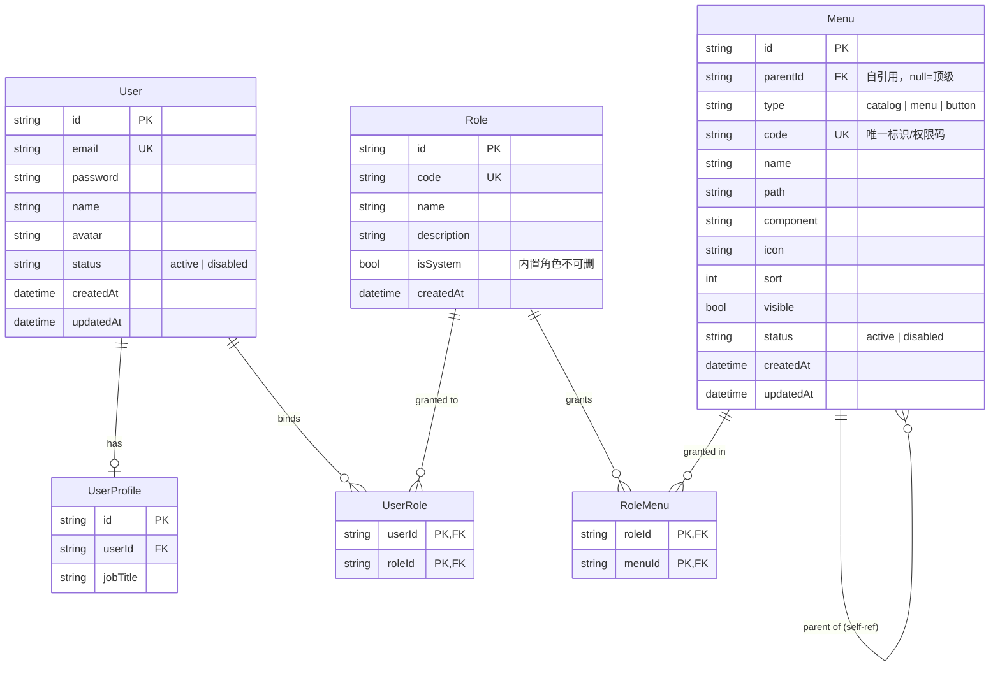
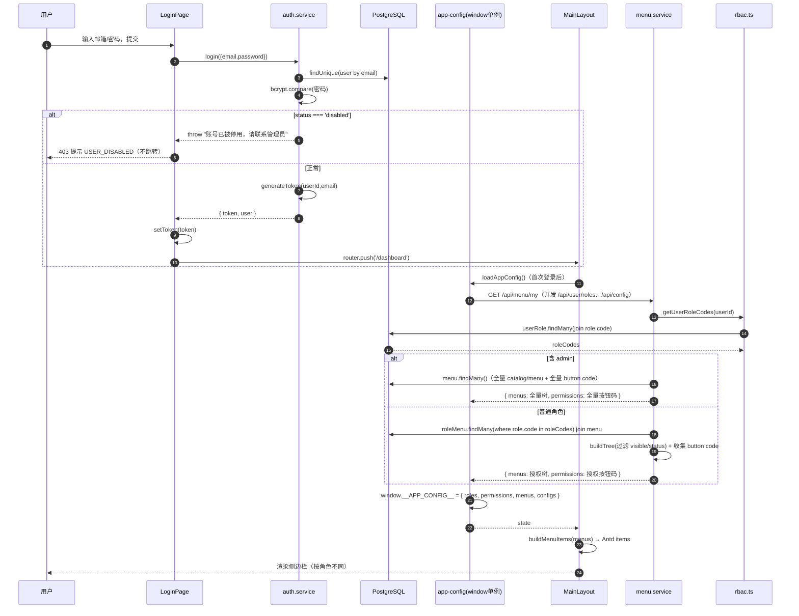
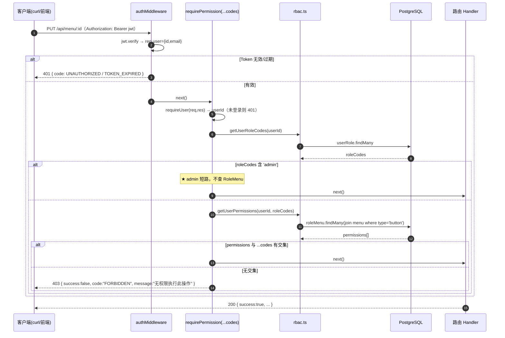
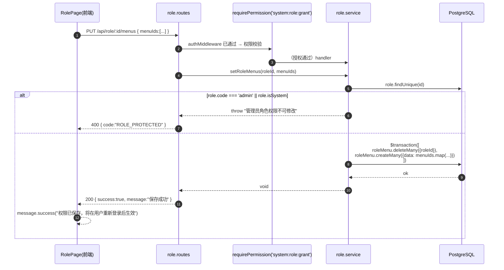
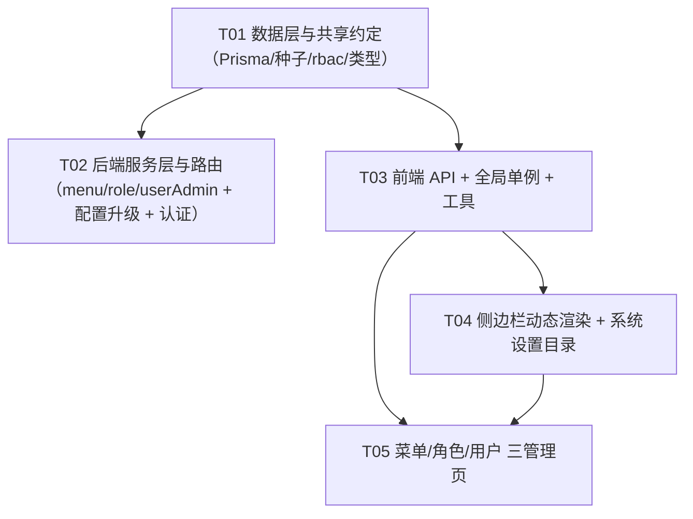

# 系统架构设计：角色-菜单权限体系（RBAC + 动态菜单）

> 版本：v1.0　|　作者：高见远（架构师）　|　状态：待评审
> 项目：ai-job-platform（CareerAI）
> 上游输入：`docs/prd-rbac-menu.md`（许清楚，PRD v1.0）
> 设计范围：P0 全量（13 条）+ P1 全部（9 条）；P2 仅预留扩展位，不实现。

---

## 目录

1. [实现方案与总体设计](#1-实现方案与总体设计)
2. [框架与库选型](#2-框架与库选型)
3. [文件列表及相对路径](#3-文件列表及相对路径)
4. [数据结构与接口](#4-数据结构与接口)
5. [程序调用流程](#5-程序调用流程)
6. [任务列表](#6-任务列表)
7. [依赖包列表](#7-依赖包列表)
8. [共享知识 / 跨文件约定](#8-共享知识--跨文件约定)
9. [待明确事项](#9-待明确事项)

---

## 1. 实现方案与总体设计

### 1.1 核心挑战

| 挑战 | 说明 | 应对 |
|---|---|---|
| **前端硬编码菜单 → 接口驱动** | `MainLayout.tsx` 现为写死的 `items`（key 1–6），需改为消费后端菜单树，且不能破坏微前端入口（`/dashboard/resume`）与选中态 | 新增 `GET /api/menu/my`，`MainLayout` 消费 window 单例中的 `menus`，用工具函数把后端树映射为 Antd `MenuProps.items` |
| **权限粒度从「角色」下沉到「权限码」** | 现有 `requireRole(...codes)` 只到角色级；新体系要求「菜单+按钮」级权限码 | 新增 `requirePermission(...codes)`，语义「拥有任一 code 即放行」，admin 短路放行，实时读库 |
| **admin 强制全权、不可编辑/删除** | 一旦误改会把系统锁死 | 后端三处强制：① `requirePermission` 短路 ② `getUserMenuTree` 短路返全量 ③ `role.service` 拒绝改/删 admin 角色；前端仅做置灰体验（双保险） |
| **菜单树自引用 + 三类节点统一建模** | catalog/menu/button 三种类型，层级不定 | 单表 `Menu` 自引用（`parentId`），`type` 区分；`code` 唯一即为「权限码」 |
| **权限变更生效口径** | 不实时推送，前端菜单重新登录后刷新；但后端鉴权必须实时 | 后端**每次请求实时查库**（不缓存用户权限）；前端 window 单例仅作体验层展示 |
| **停用用户** | 登录拦截（P0）+ 已登录踢下线（P1） | P0：`login()` 校验 `status`；P1：`authMiddleware` 追加 `status` 校验 |
| **旧路径兼容** | 书签 `/dashboard/settings` 失效 | 保留该路由并 `redirect` 到 `/dashboard/system/config` |

### 1.2 分层架构

```
┌───────────────────────────────────────────────────────────────────────┐
│  前端（my-app / Next.js 16 App Router）                                 │
│  ┌─────────────────────────────────────────────────────────────────┐  │
│  │ 页面层  app/dashboard/system/{config,menu,role,user}/page.tsx    │  │
│  │ 布局层  components/layout/MainLayout.tsx（动态侧边栏）           │  │
│  │ 状态层  lib/app-config.ts（window 单例：roles/permissions/menus）│  │
│  │ 工具层  lib/permissions.ts（权限码常量/hasPermission）           │  │
│  │         lib/menu-icons.tsx（图标名→组件） lib/menu-tree.ts（树映射）│ │
│  │ API 层  api/client.ts + api/modules/{menu,role,user}.ts          │  │
│  └─────────────────────────────────────────────────────────────────┘  │
└───────────────────────────────┬───────────────────────────────────────┘
                                 │ HTTP (JWT in Authorization)
┌───────────────────────────────▼───────────────────────────────────────┐
│  后端（my-app/server / Express 5 + Prisma 7）                          │
│  ┌─────────────────────────────────────────────────────────────────┐  │
│  │ 路由层  routes/{menu,role,adminUser}.routes.ts + config.routes   │  │
│  │ 中间件  middleware/auth.ts（验票） + middleware/rbac.ts（授权）   │  │
│  │ 服务层  services/{menu,role,userAdmin}.service.ts                │  │
│  │ 数据层  prisma/schema.prisma（Menu/RoleMenu/User.status）        │  │
│  └─────────────────────────────────────────────────────────────────┘  │
└───────────────────────────────┬───────────────────────────────────────┘
                                 │ Prisma
                        ┌────────▼────────┐
                        │  PostgreSQL 16  │
                        └─────────────────┘
```

**分层职责边界**
- **数据层**：`Menu`（树 + 权限码）、`RoleMenu`（角色-菜单绑定）、`User.status`。单一事实源。
- **服务层**：菜单树的构建/校验/CRUD、角色与绑定、管理侧用户操作。所有业务规则（唯一性、禁止删除含子节点、admin 保护）在此收敛。
- **路由层**：定义端点、挂 `authMiddleware` + `requirePermission`，做入参基础校验，错误映射（400/403/409）。
- **前端**：静态体验层（菜单/按钮显隐）+ 表单交互；**不承担安全职责**（安全边界在后端）。

### 1.3 关键设计决策（含主理人 8 条拍板）

| # | 决策 | 落地方式 |
|---|---|---|
| D1 | 角色 `code` 创建后不可修改 | `role.service.updateRole` 只更新 `name/description`，忽略/拒绝 `code` 变更 |
| D2 | 禁止删除含子节点的菜单 | `menu.service.deleteMenu` 先 `count({parentId})`，>0 抛业务错误 → 400 |
| D3 | catalog 目录也需要权限码 | `system` 目录 `code="system"`，与 menu/button 一致纳入 `RoleMenu` |
| D4 | 保留 `user` 为受保护内置角色 | `Role` 新增 `isSystem Boolean`（admin/user 均 true），`deleteRole` 拒绝 `isSystem` |
| D5 | 新注册用户自动绑定 `user` 角色 | `auth.service.register` 事务内 upsert `UserRole(user, userRole)` |
| D6 | 停用用户：P0 登录拦截 + P1 踢下线 | P0 `login` 校验 `status`；P1 `authMiddleware` 追加 `status` 校验 |
| D7 | 旧路径 `/dashboard/settings` 重定向 | 该页面改为 `redirect('/dashboard/system/config')` |
| D8 | 业务菜单本期只做菜单级权限 | 只入库 `dashboard/jobs/resume/profile/history` 5 个 menu，不建 button |

> 补充决策：`admin` 角色**永不写 `RoleMenu` 记录**，鉴权/取菜单时按角色名短路返回全量（避免绑定数据与代码规则冲突）。

---

## 2. 框架与库选型

| 层 | 选型 | 理由 |
|---|---|---|
| 前端 | Next.js 16 App Router + React 19 + TypeScript | 沿用现有栈，`app/dashboard/system/*` 直接以目录路由落地 |
| 前端 UI | Ant Design 6（`Menu`/`Tree`/`Table`/`Modal`/`Form`）+ Tailwind 4 | 沿用；菜单树、权限勾选树、树形表格 Antd 原生支持，无需自研 |
| 前端请求 | 现有 axios 单例 `api/client.ts` | 沿用；新增 `modules/{menu,role}.ts` 即可 |
| 后端 | Express 5 + TypeScript（ESM，相对 import 带 `.js`） | 沿用 |
| ORM/DB | Prisma 7 + PostgreSQL 16 | 沿用；`Menu` 自引用 + `RoleMenu` 复合主键原生支持 |
| 鉴权 | JWT + bcrypt（现有 `authMiddleware`/`requireUser`） | 沿用，不引额外鉴权库 |

**为什么不引入第三方权限库（如 Casbin / AccessControl / @casl）？**

1. **语义需求简单且已明确**：本质是「角色 → 菜单/权限码集合」的多对多，`RoleMenu` + `Set` 判断即可覆盖，无需 RBAC-DSL。
2. **与现有代码冲突成本高**：项目已有 `ROLE_CODES`/`getUserRoleCodes`/`requireRole` 与 JWT 体系，引入库需重写鉴权链路，收益低。
3. **admin 短路等业务规则是定制逻辑**：Casbin 的 policy 模型反而要额外适配「admin 全权不可编辑」，不如手写 3 行 `if (roles.includes('admin')) return true`。
4. **可控与可测**：权限是安全边界，代码量小、逻辑显式、易审计，优于黑盒库。
5. **严格遵循主理人约束**：禁止引入新的前端框架或第三方权限库。

> 因此权限体系**纯手写**：后端 `middleware/rbac.ts` 收敛授权逻辑，权限码为字符串常量集中定义。

---

## 3. 文件列表及相对路径

> 路径均相对于 `ai-job-platform/`。行号基于当前代码版本，供工程师定位改动点。

### 3.1 后端（my-app/server）

| # | 文件 | 新增/修改 | 改动点 / 行号范围 |
|---|---|---|---|
| B1 | `my-app/server/prisma/schema.prisma` | **修改** | ① `User` 模型新增 `status`（约 L63 后）；② `Role` 模型新增 `isSystem` + `menus RoleMenu[]`（约 L249 前）；③ 文件末尾（L320 后）追加 `model Menu`、`model RoleMenu` |
| B2 | `my-app/server/prisma/seed-roles.ts` | **修改** | ① 头部 import 追加 `PERMISSION_CODES`（L29）；② 步骤 2 与步骤 3 之间（约 L59 后）插入「菜单树 upsert + user 角色绑定」逻辑；③ 保持幂等 |
| B3 | `my-app/server/src/middleware/rbac.ts` | **修改** | 在 `requireRole`（L107）之后追加：`PERMISSION_CODES` 常量、`isAdminRole()`、`getUserPermissions()`、`getUserMenuTree()`、`requirePermission()` |
| B4 | `my-app/server/src/types/index.ts` | **修改** | 文件末尾追加 `MenuType`、`MenuTreeNode`、`RoleListItem`、`AdminUserItem`、`CreateMenuInput` 等共享类型 |
| B5 | `my-app/server/src/services/menu.service.ts` | **新增** | 菜单树构建、CRUD、权限码校验、按用户取菜单 |
| B6 | `my-app/server/src/services/role.service.ts` | **新增** | 角色 CRUD、角色-菜单绑定、admin/内置角色保护 |
| B7 | `my-app/server/src/services/userAdmin.service.ts` | **新增** | 用户列表（分页+搜索）、分配角色、启停 |
| B8 | `my-app/server/src/routes/menu.routes.ts` | **新增** | `/api/menu/*` 端点 |
| B9 | `my-app/server/src/routes/role.routes.ts` | **新增** | `/api/role/*` 端点 |
| B10 | `my-app/server/src/routes/adminUser.routes.ts` | **新增** | `/api/user/list`、`/api/user/:id/roles`、`/api/user/:id/status` |
| B11 | `my-app/server/src/app.ts` | **修改** | ① import 区（L21–26）追加三个 Router；② 挂载区（L160 后）追加 `app.use("/api/menu", …)`、`app.use("/api/role", …)`、`app.use("/api/user", adminUserRouter)` |
| B12 | `my-app/server/src/routes/config.routes.ts` | **修改** | 写接口的 `requireRole(ROLE_CODES.ADMIN)`（L109/158/201/240/259）升级为 `requirePermission(PERMISSION_CODES.CONFIG_UPDATE)`；import（L31）同步调整 |
| B13 | `my-app/server/src/services/auth.service.ts` | **修改** | ① `login()` 密码校验后（约 L166 后）追加 `status==='disabled'` 拦截；② `register()` 创建用户后（约 L102 后）自动绑定 `user` 角色 |
| B14 | `my-app/server/src/controllers/auth.controller.ts` | **修改** | `login` 的 catch（L169–182）追加 `USER_DISABLED` 分支 → 403 |

### 3.2 前端（my-app）

| # | 文件 | 新增/修改 | 改动点 / 行号范围 |
|---|---|---|---|
| F1 | `my-app/api/types.ts` | **修改** | 文件末尾追加 `MenuType`、`MenuTreeNode`、`MyMenuResult`、`RoleItem`、`RoleMenuItem`、`AdminUserItem`、`AssignRolesParams` 等类型；`ErrorCode`/`ERROR_MESSAGES`（约 L409 附近）追加 `USER_DISABLED`、`FORBIDDEN` |
| F2 | `my-app/api/modules/menu.ts` | **新增** | `getMyMenuApi`、`getMenuTreeApi`、`createMenuApi`、`updateMenuApi`、`deleteMenuApi` |
| F3 | `my-app/api/modules/role.ts` | **新增** | `getRoleListApi`、`createRoleApi`、`updateRoleApi`、`deleteRoleApi`、`getRoleMenusApi`、`setRoleMenusApi` |
| F4 | `my-app/api/modules/user.ts` | **修改** | 文件末尾追加 `getUserListApi`、`assignUserRolesApi`、`setUserStatusApi` |
| F5 | `my-app/api/index.ts` | **修改** | 导出 F2/F3/F4 新增函数与类型 |
| F6 | `my-app/lib/app-config.ts` | **修改** | ① `AppConfigState` 扩展 `permissions`/`menus`（L34–41）；② `loadAppConfig` 增加 `getMyMenuApi` 拉取（L106–115）；③ `clearAppConfig` 一并清空（L126–131）；④ 末尾新增 `hasPermission()`（L201 后） |
| F7 | `my-app/lib/permissions.ts` | **新增** | 前端权限码常量 `PERMISSIONS` 与命名规范正则，供按钮级控制 |
| F8 | `my-app/lib/menu-icons.tsx` | **新增** | 图标名（string）→ Antd 图标组件映射表 |
| F9 | `my-app/lib/menu-tree.ts` | **新增** | `buildMenuItems(MenuTreeNode[])`：后端树 → Antd `MenuProps['items']`；`findOpenKeysDeep` |
| F10 | `my-app/components/layout/MainLayout.tsx` | **修改** | 删除硬编码 `items`（L198–214）、重写 `handleMenuClick`（L115–142）与 `getSelectedKey`（L149–156）；改用 `menus` + `buildMenuItems` + `hasPermission`；接口失败降级渲染默认菜单 |
| F11 | `my-app/app/dashboard/layout.tsx` | **修改** | 在守卫 effect（L25–43）内追加「菜单/权限兜底加载」调用（`loadAppConfig` 已在 MainLayout 触发，这里仅保证 403 判断可用） |
| F12 | `my-app/app/dashboard/system/layout.tsx` | **新增** | 系统设置子目录级权限守卫（P1-3）：无 `system` 权限则渲染 403 提示 |
| F13 | `my-app/app/dashboard/system/config/page.tsx` | **新增** | 由 `settings/page.tsx` **平移**，内容与交互完全不变，仅改文件位置 |
| F14 | `my-app/app/dashboard/system/menu/page.tsx` | **新增** | 菜单管理页（树形表格 + 新增/编辑/删除弹窗 + 图标选择器 + 权限码校验） |
| F15 | `my-app/app/dashboard/system/role/page.tsx` | **新增** | 角色管理页（列表 + 分配权限树弹窗 + admin 置灰） |
| F16 | `my-app/app/dashboard/system/user/page.tsx` | **新增** | 用户管理页（列表 + 分配角色 + 启停 + 搜索分页） |
| F17 | `my-app/app/dashboard/settings/page.tsx` | **修改** | 改为重定向到 `/dashboard/system/config`（旧路径兼容 D7） |

**统计：新增 11 个（后端 6 + 前端 5：F7/F8/F9/F12/F13–F16 中 config 为平移新增）、修改 13 个。**

> 说明：F13 属「平移」——原 `settings/page.tsx` 的完整实现搬到新路径；原文件（F17）改为重定向。净新增实现文件数为 F13 + F14 + F15 + F16 共 4 个页面。

---

## 4. 数据结构与接口

### 4.1 Prisma 数据模型（erDiagram）



**模型定义（新增/修改，写入 `schema.prisma`）**

```prisma
// —— Menu：目录/菜单/按钮 三类型统一建模，自引用成树 ——
model Menu {
  id         String   @id @default(uuid()) @map("id")
  parentId   String?  @map("parent_id")
  type       String   @map("type")            // catalog | menu | button
  code       String   @unique @map("code")    // 唯一标识；button 即权限码
  name       String   @map("name")
  path       String?  @map("path")
  component  String?  @map("component")
  icon       String?  @map("icon")
  sort       Int      @default(0) @map("sort")
  visible    Boolean  @default(true) @map("visible")
  status     String   @default("active") @map("status") // active | disabled
  createdAt  DateTime @default(now()) @map("created_at")
  updatedAt  DateTime @updatedAt @map("updated_at")

  parent     Menu?     @relation("MenuTree", fields: [parentId], references: [id])
  children   Menu[]    @relation("MenuTree")
  roles      RoleMenu[]

  @@index([parentId])
  @@map("menus")
}

// —— RoleMenu：角色-菜单绑定（多对多，双向级联删除）——
model RoleMenu {
  roleId String @map("role_id")
  menuId String @map("menu_id")
  role   Role   @relation(fields: [roleId], references: [id], onDelete: Cascade)
  menu   Menu   @relation(fields: [menuId], references: [id], onDelete: Cascade)
  @@id([roleId, menuId])
  @@map("role_menus")
}

// —— Role 修改：新增 isSystem + menus 关系（在 L249 前插入）——
//   isSystem  Boolean   @default(false) @map("is_system")
//   menus      RoleMenu[]

// —— User 修改：新增 status（表结构变更，存量默认 active）——
//   status     String   @default("active") @map("status")  // active | disabled
```

> **迁移说明**：`User.status` 有 `@default("active")`，迁移后存量用户全部为 `active`，不影响现有登录（PRD P0-11 ④）。`Role.isSystem` 默认 `false`，由种子脚本把 admin/user 置 `true`。

### 4.2 后端服务类结构（classDiagram）

```mermaid
classDiagram
  class RBAC_Middleware {
    <<module rbac.ts>>
    +ROLE_CODES : const
    +PERMISSION_CODES : const
    +getUserRoleCodes(userId) Promise~string[]~
    +isAdminRole(roleCodes) boolean
    +getUserPermissions(userId, roleCodes) Promise~string[]~
    +getUserMenuTree(userId, roleCodes) Promise~MenuTreeNode[]~
    +requireRole(...codes) Middleware
    +requirePermission(...codes) Middleware
  }

  class MenuService {
    +buildTree(menus) MenuTreeNode[]
    +getMyMenus(userId, roleCodes) Promise~{menus,permissions}~
    +getFullTree() Promise~Menu[]~
    +createMenu(input, operatorId) Promise~Menu~
    +updateMenu(id, input, operatorId) Promise~Menu~
    +deleteMenu(id) Promise~void~
    +validatePermissionCode(code) void
  }

  class RoleService {
    +listRoles() Promise~RoleListItem[]~
    +createRole(input) Promise~Role~
    +updateRole(id, input) Promise~Role~
    +deleteRole(id) Promise~void~
    +getRoleMenuIds(roleId) Promise~string[]~
    +setRoleMenus(roleId, menuIds) Promise~void~
  }

  class UserAdminService {
    +listUsers({keyword,page,pageSize}) Promise~{items,total}~
    +assignRoles(userId, roleIds) Promise~void~
    +setStatus(userId, status, operatorId) Promise~void~
  }

  class MenuValidationError {
    <<Error>>
    +name : string
  }

  MenuService ..> MenuValidationError : throws
  RoleService ..> MenuValidationError : throws
  UserAdminService ..> MenuValidationError : throws
  RBAC_Middleware --> MenuService : reuses buildTree
  RoleService --> RBAC_Middleware : ROLE_CODES
```

> 说明：`MenuValidationError`（业务校验错误，路由层 `instanceof` 识别 → 400）与现有 `ConfigValidationError` 同构，可复用命名风格；若倾向复用，可直接 `import { ConfigValidationError }`，但独立类语义更清晰，建议新建。

### 4.3 接口契约

> **统一响应格式（严格对齐现有代码，非 PRD 附录模板）**：
> 成功 `{ success: true, message: string, data: T }`；失败 `{ success: false, message: string, code: string }`。
> 鉴权中间件在 `Authorization: Bearer <jwt>` 下工作。

#### 4.3.1 菜单相关（`/api/menu`）

| 方法 | 路径 | 权限 | 请求 | 成功响应 `data` |
|---|---|---|---|---|
| GET | `/api/menu/my` | 登录（`authMiddleware`） | — | `{ menus: MenuTreeNode[], permissions: string[] }`，已按 `sort` 升序、剔除 `button`；admin 返全量 |
| GET | `/api/menu/tree` | `system:menu` | — | `Menu[]`（全量，含 button，树形或平铺+父ID，见下） |
| POST | `/api/menu` | `system:menu:create` | `CreateMenuInput` | `Menu` |
| PUT | `/api/menu/:id` | `system:menu:update` | `UpdateMenuInput` | `Menu` |
| DELETE | `/api/menu/:id` | `system:menu:delete` | — | `null` |

**`MenuTreeNode`（接口返回，catalog/menu 两级）**
```ts
interface MenuTreeNode {
  id: string;
  code: string;
  name: string;
  path?: string;        // menu 有；catalog 无
  icon?: string;        // 图标名（前端映射组件）
  sort: number;
  children?: MenuTreeNode[];
}
```

**`CreateMenuInput` / `UpdateMenuInput`**
```ts
interface CreateMenuInput {
  parentId: string | null;   // null = 顶级
  type: 'catalog' | 'menu' | 'button';
  code: string;              // 权限码，需符合规范且全局唯一
  name: string;
  path?: string | null;      // button 忽略
  component?: string | null;
  icon?: string | null;      // button 忽略
  sort?: number;
  visible?: boolean;         // button 忽略
  status?: 'active' | 'disabled';
}
type UpdateMenuInput = Partial<CreateMenuInput>; // code 允许改但需唯一；parentId/type 关键字段建议前端只读
```
> `GET /api/menu/tree` 返回**平铺数组**（前端树形表格用 `parentId` 组织成 `treeData`），避免顺序歧义；如需树形可加 `?as=tree`。

#### 4.3.2 角色相关（`/api/role`）

| 方法 | 路径 | 权限 | 请求 | 成功响应 `data` |
|---|---|---|---|---|
| GET | `/api/role/list` | `system:role` | — | `RoleListItem[]` |
| POST | `/api/role` | `system:role:create` | `{ code, name, description? }` | `Role` |
| PUT | `/api/role/:id` | `system:role:update` | `{ name?, description? }`（**忽略 code**） | `Role` |
| DELETE | `/api/role/:id` | `system:role:delete` | — | `null`（含用户或内置角色 → 400） |
| GET | `/api/role/:id/menus` | `system:role` | — | `{ menuIds: string[] }` |
| PUT | `/api/role/:id/menus` | `system:role:grant` | `{ menuIds: string[] }` | `null`（admin → 400） |

**`RoleListItem`**
```ts
interface RoleListItem {
  id: string;
  code: string;
  name: string;
  description: string | null;
  isSystem: boolean;      // admin/user = true，前端据此置灰
  userCount: number;      // 关联用户数（删除前置校验展示）
  menuCount: number | null; // admin 为 null（表示"全部权限"）
}
```

#### 4.3.3 用户管理相关（`/api/user`，管理侧）

| 方法 | 路径 | 权限 | 请求 | 成功响应 `data` |
|---|---|---|---|---|
| GET | `/api/user/list` | `system:user` | `?keyword=&page=1&pageSize=10` | `{ items: AdminUserItem[], total, page, pageSize }` |
| PUT | `/api/user/:id/roles` | `system:user:grant` | `{ roleIds: string[] }` | `null` |
| PUT | `/api/user/:id/status` | `system:user:disable` | `{ status: 'active'\|'disabled' }` | `null`（操作自己 → 400） |

**`AdminUserItem`**
```ts
interface AdminUserItem {
  id: string;
  email: string;
  name: string | null;
  roles: { id: string; code: string; name: string }[];
  status: 'active' | 'disabled';
  createdAt: string;
}
```

#### 4.3.4 配置中心写接口（改造）

| 方法 | 路径 | 原权限 | 新权限 |
|---|---|---|---|
| POST/PUT/DELETE | `/api/config*` | `requireRole(admin)` | `requirePermission('system:config:update')` |

> 读接口（GET `/api/config`）保持对所有登录用户开放，不变。

#### 4.3.5 认证接口（改造）

| 方法 | 路径 | 变更 |
|---|---|---|
| POST | `/api/auth/login` | 新增：`status==='disabled'` → `403 { success:false, code:"USER_DISABLED", message:"账号已被停用，请联系管理员" }` |
| POST | `/api/auth/register` | 新增：注册事务内自动绑定 `user` 角色 |

### 4.4 权限码常量（`PERMISSION_CODES`，后端 & 前端各一份，值须一致）

| 常量名 | 值 | 用途 |
|---|---|---|
| `SYSTEM` | `system` | 系统设置目录 |
| `SYSTEM_CONFIG` | `system:config` | 基础配置菜单 |
| `SYSTEM_MENU` | `system:menu` | 菜单管理菜单 |
| `SYSTEM_ROLE` | `system:role` | 角色管理菜单 |
| `SYSTEM_USER` | `system:user` | 用户管理菜单 |
| `CONFIG_UPDATE` | `system:config:update` | 保存/恢复配置（按钮） |
| `MENU_CREATE` | `system:menu:create` | 新增菜单 |
| `MENU_UPDATE` | `system:menu:update` | 编辑菜单 |
| `MENU_DELETE` | `system:menu:delete` | 删除菜单 |
| `ROLE_CREATE` | `system:role:create` | 新增角色 |
| `ROLE_UPDATE` | `system:role:update` | 编辑角色 |
| `ROLE_DELETE` | `system:role:delete` | 删除角色 |
| `ROLE_GRANT` | `system:role:grant` | 分配权限 |
| `USER_GRANT` | `system:user:grant` | 分配角色 |
| `USER_DISABLE` | `system:user:disable` | 停用用户 |

> 业务菜单码 `dashboard/jobs/resume/profile/history` 本期不作按钮权限，仅作 menu 节点的 `code`。

### 4.5 种子数据（`seed-roles.ts` 写入基线，对齐 PRD 3.4）

| 层级 | type | name | code | path | icon | sort | 绑定 |
|---|---|---|---|---|---|---|---|
| 1 | menu | 工作台 | `dashboard` | `/dashboard` | `dashboard` | 10 | user |
| 1 | menu | 职位发现 | `jobs` | `/dashboard/jobs` | `project` | 20 | user |
| 1 | menu | 简历优化 | `resume` | `/dashboard/resume` | `file-text` | 30 | user |
| 1 | menu | 个人中心 | `profile` | `/dashboard/profile` | `user` | 40 | user |
| 1 | menu | 决策历史 | `history` | `/dashboard/history` | `history` | 50 | user |
| 1 | catalog | 系统设置 | `system` | — | `setting` | 90 | （仅 admin，不写绑定） |
| 2 | menu | 基础配置 | `system:config` | `/dashboard/system/config` | `setting` | 10 | — |
| 2 | menu | 菜单管理 | `system:menu` | `/dashboard/system/menu` | `menu` | 20 | — |
| 2 | menu | 角色管理 | `system:role` | `/dashboard/system/role` | `team` | 30 | — |
| 2 | menu | 用户管理 | `system:user` | `/dashboard/system/user` | `usergroup` | 40 | — |
| 3 | button | 保存配置 | `system:config:update` | — | — | 10 | — |
| 3 | button | 新增菜单 | `system:menu:create` | — | — | 10 | — |
| 3 | button | 编辑菜单 | `system:menu:update` | — | — | 20 | — |
| 3 | button | 删除菜单 | `system:menu:delete` | — | — | 30 | — |
| 3 | button | 新增角色 | `system:role:create` | — | — | 10 | — |
| 3 | button | 编辑角色 | `system:role:update` | — | — | 20 | — |
| 3 | button | 删除角色 | `system:role:delete` | — | — | 30 | — |
| 3 | button | 分配权限 | `system:role:grant` | — | — | 40 | — |
| 3 | button | 分配角色 | `system:user:grant` | — | — | 10 | — |
| 3 | button | 停用用户 | `system:user:disable` | — | — | 20 | — |

> 种子脚本**幂等**：菜单按 `code` upsert；`user` 仅绑定 5 个业务菜单；`admin` **不写 RoleMenu**（走短路）。二级/三级菜单默认不绑 `user`（admin 天然可见）。

---

## 5. 程序调用流程

### 5.1 时序图：登录后获取菜单



### 5.2 时序图：`requirePermission` 鉴权中间件



> **P1-4 增强**：`authMiddleware` 在 `jwt.verify` 通过后追加 `prisma.user.findUnique({select:{status}})`，`disabled` → `401 { code:"USER_DISABLED" }`，实现「停用即踢下线」。此为 P1，可在 T02 一并落地。

### 5.3 时序图：角色绑定菜单保存



---

## 6. 任务列表

> **共 5 个任务**（硬性上限内）。按依赖顺序排列，第一个为「数据层 + 共享约定」基础设施（本项目脚手架已存在，故基础设施=数据模型与跨层常量/类型）。每个任务含涉及文件 + 验收点。

### T01 · 数据层与共享约定（Prisma 模型 + 迁移 + 种子 + 鉴权常量 + 类型）【P0/P1】
**依赖**：无（起始任务）
**涉及文件**
- `my-app/server/prisma/schema.prisma`（改：Menu/RoleMenu/Role.isSystem/User.status）
- `my-app/server/prisma/seed-roles.ts`（改：菜单树 upsert + user 绑定）
- `my-app/server/src/middleware/rbac.ts`（改：PERMISSION_CODES + getUserPermissions + getUserMenuTree + requirePermission）
- `my-app/server/src/types/index.ts`（改：共享类型）

**施工步骤**
1. `schema.prisma`：追加 `Menu`、`RoleMenu` 两模型；`Role` 加 `isSystem Boolean @default(false)` 与 `menus RoleMenu[]`；`User` 加 `status String @default("active")`。
2. 执行 `npm run db:migrate`（`npx prisma migrate dev --name rbac_menu`）生成迁移与 Client。
3. `rbac.ts`：定义 `PERMISSION_CODES`（15 项，见 §4.4）；实现 `isAdminRole`、`getUserPermissions`、`getUserMenuTree`（admin 短路返全量）、`requirePermission`（any-match + admin 短路 + 403 FORBIDDEN）。**保留 `requireRole` 不破坏旧调用**。
4. `types/index.ts`：定义 `MenuType`、`MenuTreeNode`、`RoleListItem`、`AdminUserItem`、`CreateMenuInput/UpdateMenuInput`。
5. `seed-roles.ts`：按 §4.5 幂等 upsert 20 条菜单；给 `admin`/`user` 角色 upsert 时置 `isSystem=true`；给 `user` 绑定 5 个业务菜单；`admin` 不写绑定。

**验收点**
- [ ] `prisma migrate` 成功，`menus`/`role_menus` 表结构正确，`users.status` 默认 `active`（存量用户不受影响）。
- [ ] `npm run db:seed:roles` 可重复执行无重复数据（菜单 20 条、role_menus 5 条）。
- [ ] 单测/手测：`requirePermission('system:role:grant')` 对 admin 用户短路放行；对无权限普通用户返 403。
- [ ] `getUserMenuTree`：admin 返全量树；`user` 返 5 个业务菜单，不含 button。

---

### T02 · 后端服务层与路由（菜单/角色/用户管理 + 配置权限升级 + 认证改造）【P0/P1】
**依赖**：T01
**涉及文件**
- `my-app/server/src/services/menu.service.ts`（新）
- `my-app/server/src/services/role.service.ts`（新）
- `my-app/server/src/services/userAdmin.service.ts`（新）
- `my-app/server/src/routes/menu.routes.ts`（新）
- `my-app/server/src/routes/role.routes.ts`（新）
- `my-app/server/src/routes/adminUser.routes.ts`（新）
- `my-app/server/src/app.ts`（改：挂载三个 Router）
- `my-app/server/src/routes/config.routes.ts`（改：写接口权限码升级）
- `my-app/server/src/services/auth.service.ts`（改：停用拦截 + 注册绑 user）
- `my-app/server/src/controllers/auth.controller.ts`（改：USER_DISABLED → 403）

**施工步骤**
1. `menu.service.ts`：`buildTree`、`getMyMenus`、`getFullTree`、`createMenu/updateMenu/deleteMenu`、`validatePermissionCode`（正则 `^[a-z][a-z0-9:_-]*$` + 全局唯一）；删除前校验子节点（D2，P1-1）。
2. `role.service.ts`：`listRoles`（含 `userCount`/`menuCount`，admin 的 `menuCount=null`）、CRUD（`code` 不可改 D1、`isSystem`/`admin` 不可删 D4、删除前校验关联用户 P1-1）、`getRoleMenuIds`/`setRoleMenus`（admin 拒绝、事务重写绑定）。
3. `userAdmin.service.ts`：`listUsers`（分页 + keyword 搜 email/name，P1-8）、`assignRoles`（事务重写 UserRole）、`setStatus`（禁止操作自己）。
4. 三个 `.routes.ts`：按 §4.3 定义端点，挂 `authMiddleware` + 对应 `requirePermission`；错误统一 `{success:false, message, code}`；`instanceof MenuValidationError` → 400。
5. `app.ts`：`app.use("/api/menu", menuRouter)`、`app.use("/api/role", roleRouter)`、`app.use("/api/user", adminUserRouter)`（在 userRouter 之后，互不冲突）。
6. `config.routes.ts`：5 个写接口的 `requireRole(ROLE_CODES.ADMIN)` → `requirePermission(PERMISSION_CODES.CONFIG_UPDATE)`。
7. `auth.service.ts`：`login` 追加 status 拦截；`register` 事务内绑定 `user` 角色（D5）。
8. `auth.controller.ts`：login catch 追加 `USER_DISABLED` → 403 分支。
9. （P1-4）`authMiddleware` 追加 status 校验 → 401 `USER_DISABLED`。

**验收点**
- [ ] `curl` 无权限用户调 `/api/menu`(POST) / `/api/role`(POST) / `/api/user/list` → **403 FORBIDDEN**（P0-13 ②）。
- [ ] admin `curl` 全部通过；`/api/menu/my` 返全量（P0-3 ④）。
- [ ] 删除含子节点的菜单 → 400「请先删除子菜单」（P1-1）。
- [ ] 改/删 admin 角色、改 admin 绑定 → 400 ROLE_PROTECTED（P0-12）。
- [ ] 删除仍有用户的角色 → 400 且返回关联用户数。
- [ ] 提交非法权限码（如 `System:Role`）→ 400 可读提示（P1-2）。
- [ ] 停用用户登录 → 403「账号已被停用，请联系管理员」（P0-11）。
- [ ] 注册新用户后 `user_roles` 自动含 `user` 角色（D5）。
- [ ] 非管理员调 `POST /api/config` → 403（配置写接口升级生效，P0-13 ①）。

---

### T03 · 前端 API 层 + 全局单例 + 权限工具【P0】
**依赖**：T01（权限码常量/类型对齐）
**涉及文件**
- `my-app/api/types.ts`（改）
- `my-app/api/modules/menu.ts`（新）
- `my-app/api/modules/role.ts`（新）
- `my-app/api/modules/user.ts`（改）
- `my-app/api/index.ts`（改）
- `my-app/lib/app-config.ts`（改）
- `my-app/lib/permissions.ts`（新）
- `my-app/lib/menu-icons.tsx`（新）
- `my-app/lib/menu-tree.ts`（新）

**施工步骤**
1. `api/types.ts`：追加 §4.3 全部类型；`ErrorCode`/`ERROR_MESSAGES` 加 `USER_DISABLED`、`FORBIDDEN`。
2. `api/modules/menu.ts`/`role.ts`：封装 §4.3.1/§4.3.2 请求（沿用 `client` 单例 + try/catch 兜底模式）。
3. `api/modules/user.ts`：追加 `getUserListApi`/`assignUserRolesApi`/`setUserStatusApi`。
4. `api/index.ts`：导出新函数与类型。
5. `lib/permissions.ts`：`PERMISSIONS` 常量（值与后端 §4.4 一致）+ 命名规范正则。
6. `lib/menu-icons.tsx`：`ICON_MAP`（`dashboard/project/file-text/user/history/setting/menu/team/usergroup` → Antd 组件）+ `getMenuIcon(name)`（未知降级默认图标）。
7. `lib/menu-tree.ts`：`buildMenuItems(nodes)`（catalog→子菜单、menu→带 path 的 item）、`findOpenKeys(pathname, nodes)`（前缀匹配保证 `/dashboard/system/*` 高亮目录）。
8. `lib/app-config.ts`：`AppConfigState` 扩展 `permissions: string[]`、`menus: MenuTreeNode[]`；`loadAppConfig` 用 `Promise.all` 增加 `getMyMenuApi()`；`clearAppConfig` 清空；新增 `hasPermission(code)`（admin 恒 true，无缓存保守 false，P0-6）。

**验收点**
- [ ] `loadAppConfig()` 后 `window.__APP_CONFIG__` 含 `roles/permissions/menus/configs`。
- [ ] `hasPermission('system:role:grant')` 对 admin 用户恒 true；对未加载态返回 false。
- [ ] `clearAppConfig()` 后 `permissions`/`menus` 均清空（无越权残留）。
- [ ] `buildMenuItems` 对含 catalog 嵌套的树生成带 `children` 的 Antd items；`getMenuIcon('不存在')` 返回默认图标不报错。

---

### T04 · 侧边栏动态渲染 + 系统设置目录与页面平移【P0】
**依赖**：T03
**涉及文件**
- `my-app/components/layout/MainLayout.tsx`（改）
- `my-app/app/dashboard/system/layout.tsx`（新）
- `my-app/app/dashboard/system/config/page.tsx`（新，平移自 settings）
- `my-app/app/dashboard/settings/page.tsx`（改：重定向）
- `my-app/app/dashboard/layout.tsx`（改：兜底加载）

**施工步骤**
1. `MainLayout.tsx`：删除硬编码 `items`（L198–214）与 `switch` 跳转（L115–142）与 `getSelectedKey`（L149–156）；改为从 `getAppConfig().menus` 取树，经 `buildMenuItems` 生成 items；`onClick` 用 item 的 `path` `router.push`；选中/展开用 `findOpenKeys(pathname)` 前缀匹配；**接口失败降级**渲染 5 个业务菜单（P0-5 ⑤）；`admin` 判断改用 `hasPermission`/`menus`（保留 `isAdmin`）。
2. `app/dashboard/system/layout.tsx`：读 `getAppConfig()`，无 `system` 权限 → 渲染 403 提示（Alert + 返回工作台按钮），不白屏（P1-3）。
3. `app/dashboard/system/config/page.tsx`：把原 `settings/page.tsx` 全量内容复制过来（功能交互不变，P0-7 ②）；数据源与保存逻辑保持。
4. `app/dashboard/settings/page.tsx`：改为 `'use client'` + `useEffect` 内 `router.replace('/dashboard/system/config')`（或服务端 `redirect`），实现旧路径兼容（D7）。
5. `app/dashboard/layout.tsx`：守卫 effect 内确保菜单/权限已加载（调用 `loadAppConfig()`），供 system 目录守卫判断（P1-3）。

**验收点**
- [ ] 普通用户侧边栏仅 5 个业务菜单；admin 额外见「系统设置」可展开目录（含 4 子项）。
- [ ] 点击子菜单按 `path` 跳转；`/dashboard/system/role` 下「系统设置」目录保持展开高亮。
- [ ] `GET /api/menu/my` 失败时侧边栏回退 5 个业务菜单并提示（不白屏、不卡死）。
- [ ] 访问 `/dashboard/settings` 自动跳到 `/dashboard/system/config`。
- [ ] 普通用户直接访问 `/dashboard/system/*` 显示 403 提示页（P1-3）。

---

### T05 · 菜单管理 / 角色管理 / 用户管理三页【P0/P1】
**依赖**：T03、T04
**涉及文件**
- `my-app/app/dashboard/system/menu/page.tsx`（新）
- `my-app/app/dashboard/system/role/page.tsx`（新）
- `my-app/app/dashboard/system/user/page.tsx`（新）

**施工步骤**
1. `menu/page.tsx`：树形表格（`Table` + `treeData`），列同 PRD §4.2；新增/编辑弹窗（父级树选择 + 类型 Radio + 权限码实时正则校验 + `icon` 下拉选择器 P1-5）；选 `button` 时隐藏/清空 路由/图标/显示（P0-8 ⑤）；删除调用接口，含子节点时后端返 400 前端提示（P1-1）。
2. `role/page.tsx`：角色列表（含用户数、权限列）；分配权限弹窗用 `Tree`（`checkable`，三层父子联动，P0-9 ③）；admin 行权限列显示「全部权限（不可编辑）」+ 编辑/删除/分配按钮置灰 + Tooltip（P0-9 ④）；删除前用户数>0 拦截提示。
3. `user/page.tsx`：列表（邮箱/昵称/角色 Tag/状态 Tag/注册时间）；分配角色弹窗（`Select mode="multiple"`）；启停二次确认（P0-10 ③）；当前登录自己行停用按钮置灰 + Tooltip（P0-10 ④）；搜索框 + 分页（P1-8）；空态/加载态/错误态齐全。
4. 三页的写操作按钮用 `hasPermission(...)` 控制显隐（P1-9 按钮级权限参考实现）。
5. 所有影响权限的成功操作统一提示「将在用户重新登录后生效」；403 统一提示「无权限执行此操作」不跳转。

**验收点**
- [ ] 菜单管理：新增目录/菜单/按钮三类型均可；`button` 类型隐藏路由/图标/显示；权限码非法实时标红；删除含子节点被拦截。
- [ ] 角色管理：新增/编辑/删除生效；分配权限勾选保存后 `GET /api/role/:id/menus` 一致；admin 行全部操作置灰。
- [ ] 用户管理：分配角色后列表刷新；停用自己置灰；停用后该用户无法登录。
- [ ] 三页按钮级权限：无对应 `hasPermission` 的用户看不到写操作按钮。
- [ ] 空数据展示 Empty 引导文案；403 时弹提示且停留当前页。

---

### 任务依赖图



---

## 7. 依赖包列表

| 包 | 变化 | 说明 |
|---|---|---|
| `next` / `react` / `antd` / `tailwindcss` | 沿用（无新增） | 已在使用 |
| `@ant-design/icons` | 沿用（无新增） | 图标映射表复用其组件 |
| `express` / `prisma` / `@prisma/client` / `@prisma/adapter-pg` | 沿用（无新增） | 已在使用 |
| `jsonwebtoken` / `bcrypt` | 沿用（无新增） | 已在使用 |
| `zod`（可选） | **不引入** | 入参校验用现有手写校验风格即可，保持一致；若团队希望统一校验可后续单独提案 |

> **结论：本设计 0 新增第三方依赖。** 所有能力均由现有栈（Antd `Tree/Table/Modal/Form`、Prisma 自引用关系、现有 axios/JWT）覆盖，符合「能不加就不加」原则。

---

## 8. 共享知识 / 跨文件约定

### 8.1 权限码常量位置（**单一事实源，前后端各一份，必须一致**）
- **后端**：`my-app/server/src/middleware/rbac.ts` 导出 `PERMISSION_CODES`（15 项）。
- **前端**：`my-app/lib/permissions.ts` 导出 `PERMISSIONS`（值同后端）。
- 约定：业务代码**禁止硬编码权限码字符串**，一律引用常量。新增权限码时两处同步更新。
- 命名规范正则（前后端统一）：`/^[a-z][a-z0-9:_-]*$/`；错误提示「模块[:资源][:动作]，全小写，如 system:role:grant」。

### 8.2 菜单树构建工具位置
- **后端**：`menu.service.ts` 的 `buildTree(menus)` —— 平铺数组 → 嵌套树（按 `sort` 升序），过滤 `status==='disabled'` 与（取侧边栏时）`visible`。
- **前端**：`lib/menu-tree.ts` 的 `buildMenuItems(nodes)` —— 后端 `MenuTreeNode[]` → Antd `MenuProps['items']`；`findOpenKeys(pathname, nodes)` 做前缀匹配。

### 8.3 图标名 → Antd 组件映射表位置
- **位置**：`my-app/lib/menu-icons.tsx`，导出 `ICON_MAP` 与 `getMenuIcon(name)`。
- 约定：接口返回**字符串**（如 `dashboard`/`team`），未知图标降级为默认图标（`AppstoreOutlined`），**不报错**。

### 8.4 admin 全权短路逻辑位置（**唯一入口，三处复用**）
- `rbac.ts` 的 `isAdminRole(roleCodes)` 为唯一判断；被 `requirePermission`、`getUserPermissions`、`getUserMenuTree` 三处复用。
- 规则：**只要角色含 `admin`** → 权限校验直接 `next()`、取菜单/权限直接返全量，**不查 RoleMenu**。
- 前端对应：`hasPermission` 对 admin 恒 true；`isAdmin()` 保留向后兼容。

### 8.5 统一约定
- **API 响应格式**：成功 `{ success:true, message, data }`；失败 `{ success:false, message, code }`。（**注意：本项目实际用 `success` 布尔字段，非 PRD 附录的 `{code,data,message}`；以真实代码为准。**）
- **ESM 相对导入**：后端所有相对 `import` **必须带 `.js` 后缀**（如 `../middleware/rbac.js`）。
- **鉴权链路顺序**：`authMiddleware`（验票）→ `requirePermission`/`requireRole`（授权）→ handler。业务取 userId 一律 `requireUser(req,res)`。
- **业务错误 → HTTP 码**：校验类错误（唯一性/规范/前置条件）→ 400；权限不足 → 403；未登录 → 401；资源不存在 → 404。
- **业务校验错误类**：新增 `MenuValidationError`（`services/menu.service.ts` 导出），路由层 `instanceof` 识别 → 400，与现有 `ConfigValidationError` 同构。
- **审计（P1-6）**：如后续需要，`Menu`/`Role` 变更可加 `updatedBy`；本期先不阻塞 P0。
- **生效口径文案**：影响权限的操作成功后统一「将在用户重新登录后生效」；后端鉴权**实时生效**。

---

## 9. 待明确事项

| # | 事项 | 当前处理 |
|---|---|---|
| A1 | `GET /api/menu/tree` 返回「平铺数组 + parentId」还是「嵌套树」 | 本设计定为**平铺数组**（前端组 `treeData`），如需树形加 `?as=tree`；实现时按此约定 |
| A2 | 菜单 `code` 在编辑时是否允许修改（与角色 `code` 不同，PRD 未禁） | 设计为**允许改但需唯一校验**；若主理人希望与角色一致「不可改」，改 `updateMenu` 一处即可 |
| A3 | `Role.isSystem` 是否纳入 P0（PRD 只显式提 admin 保护、user 待定 Q4） | 本设计**同时保护 admin 与 user**（`isSystem=true` 均不可删），符合 Q4「建议 admin/user 均不可删 code」。若只保护 admin，把 user 的 `isSystem` 置 false |
| A4 | P1-4「停用踢下线」是否本期做 | 已纳入 T02 步骤 9 作为 P1；如工期紧可延后，其不影响 P0 |
| A5 | 前端 403 兜底：`system/layout.tsx` 用「渲染 403 提示」vs「重定向工作台」 | 采用**渲染 403 提示页**（不跳转，保留上下文），符合 PRD §4.5「不跳转、不白屏」 |
| A6 | 微前端子应用（简历优化）是否也消费新菜单体系 | 本期**不动子应用**，其入口 `/dashboard/resume` 由主应用菜单驱动；子应用内部权限后续单独评估 |

---

*（本文档为施工图，工程师可直接按 T01→T05 顺序实现；P2 项（角色复制/拖拽排序/实时推送/行级权限）本期不实现，模型已预留扩展位。）*
